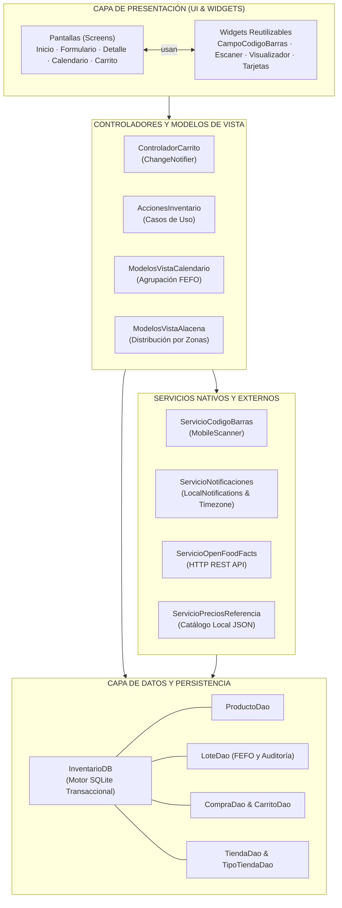
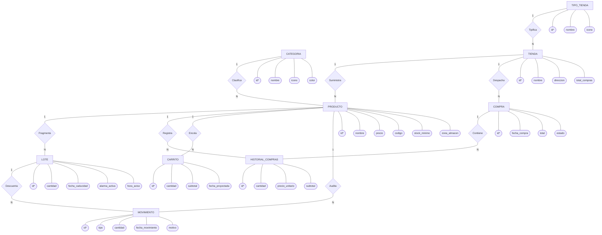
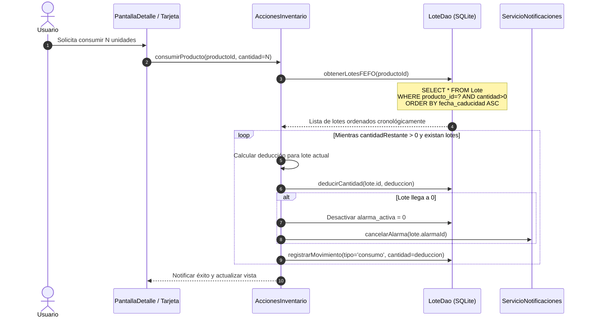
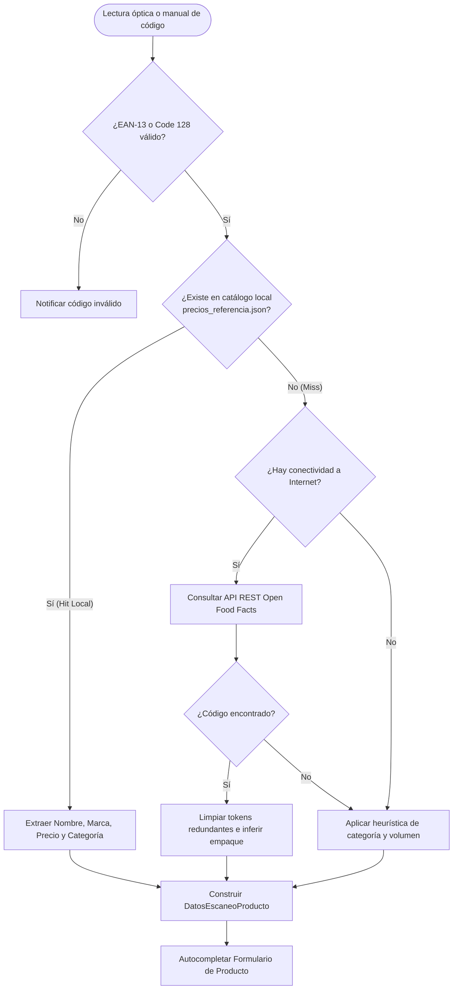
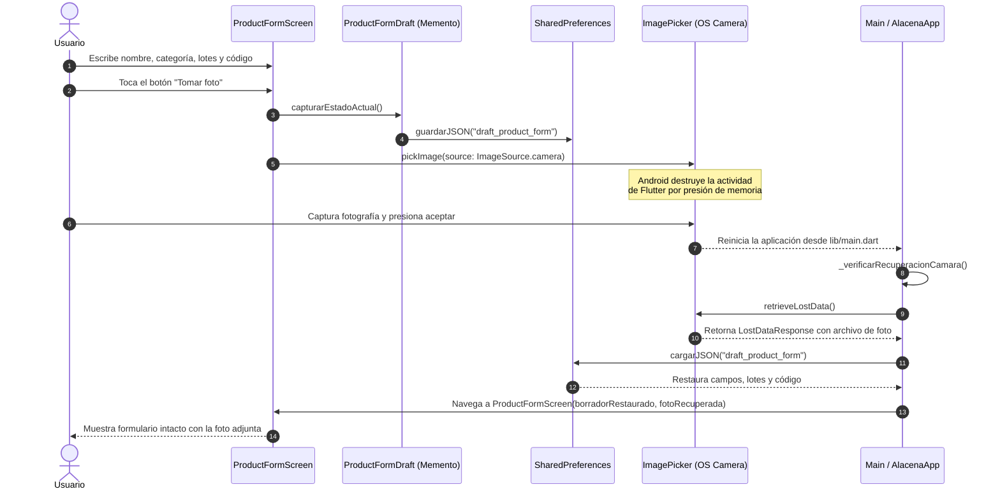
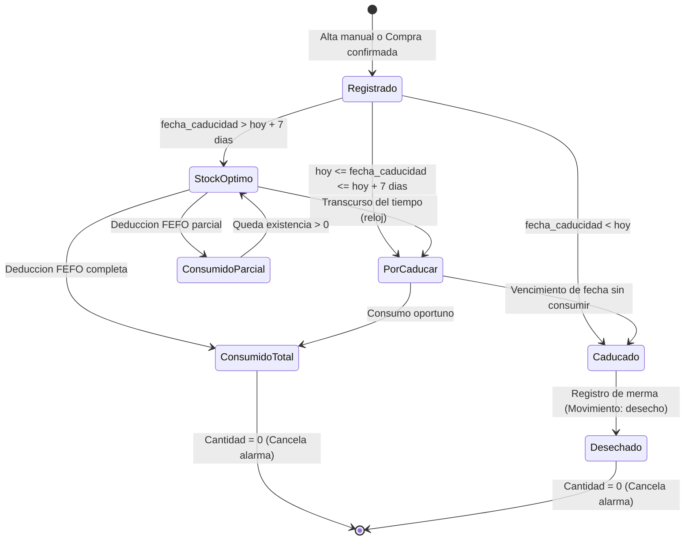
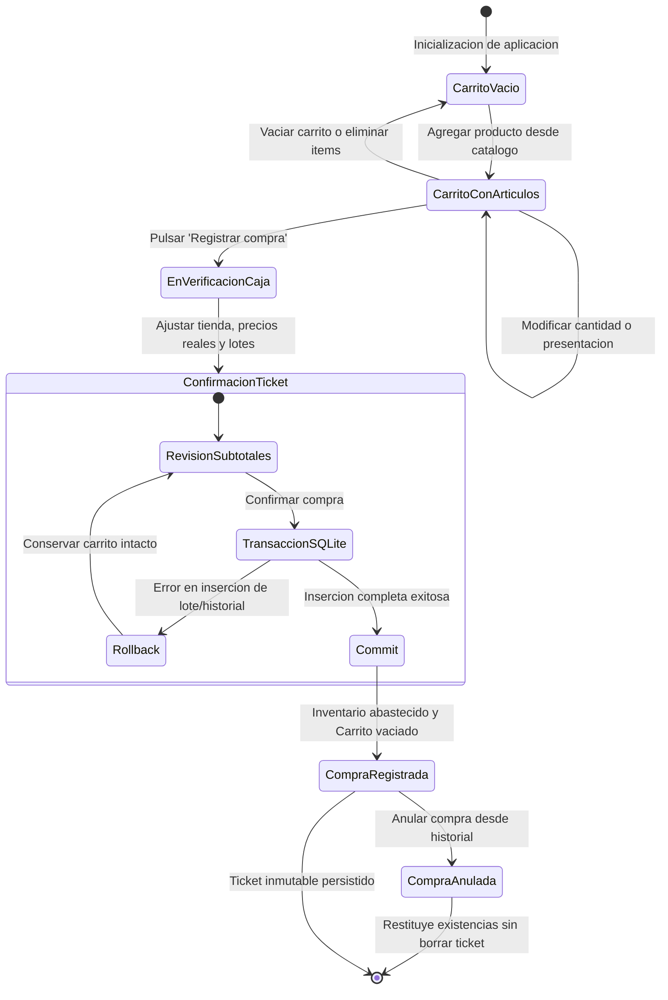

# Alacena: Sistema de Gestión de Inventario y Control de Caducidades

Este proyecto surge a partir de la práctica propuesta por el profesor Rubén Torres Frías para la materia de Desarrollo de Aplicaciones Móviles y Tecnologías en la Nube. La actividad consistía en diseñar e implementar una aplicación móvil completa que utilizara una base de datos local para resolver un problema cotidiano real: el descontrol en la despensa del hogar y el desperdicio de comida que ocurre cuando los alimentos se quedan olvidados en el fondo de la alacena y caducan sin que nos demos cuenta.

Para resolver esta problemática desarrollamos **Alacena**, una aplicación móvil en Flutter respaldada por una base de datos local en SQLite. La app ayuda a llevar el inventario de lo que tenemos en casa organizando los productos por lotes y fechas de caducidad bajo el principio FEFO (*First Expired, First Out*), lo que significa que el sistema siempre nos avisa y prioriza consumir primero lo que está más próximo a vencer. Además, incluye herramientas útiles para el día a día como escaneo de códigos de barras con la cámara para registrar productos rápidamente, generación de códigos en pantalla, captura de fotos, notificaciones automáticas antes de que caduquen los alimentos y una lista de compras que estima los gastos del súper.

---

### Índice

| Sección | Descripción |
|---|---|
| [1. Integrantes](#integrantes-y-perfiles-de-github) | Autores |
| [2. Justificación](#contexto-y-justificación-del-proyecto) | Problemática y metodología FEFO |
| [3. Arquitectura](#arquitectura-del-sistema) | Arquitectura y patrones de diseño |
| [4. Base de Datos](#modelo-de-datos-relacional-en-sqlite) | Diagrama ER y Script de BD |
| [5. Algoritmos](#procesos-y-algoritmos-principales) | Consumo FEFO y escaneo |
| [6. Estados](#modelado-formal-de-ciclos-de-vida-y-máquinas-de-estado) | Ciclos de vida de lotes y compras |
| [7. Precios Offline](#origen-y-procesamiento-del-dataset-offline-de-precios) | Catálogo de productos |
| [8. Código Fuente](#estructura-del-proyecto-y-desglose-de-lib) | Desglose de los archivos en `lib/` |
| [9. Casos de Uso](#casos-de-uso-del-sistema) | Flujos operativos de la aplicación |
| [10. Evidencias](#galería-de-evidencias-del-sistema) | Capturas de la aplicación en ejecución |
| [11. Instalación](#configuración-y-ejecución-local) | Guía de clonación, pruebas y compilación |
| [12. Conclusiones](#conclusiones) | Reflexiones y conclusiones |

*Tabla 1. Índice de navegación del proyecto Alacena. Fuente: elaboración propia.*

---

## Integrantes y perfiles de GitHub

| Jesús Alejandro Elguera Tovar | Andrés Monjaras Ortega |
|:---:|:---:|
| [](https://github.com/jesustovaarr) | [](https://github.com/AndresMonjaras) |
| [@jesustovaarr](https://github.com/jesustovaarr) | [@AndresMonjaras](https://github.com/AndresMonjaras) |

*Tabla 2. Integrantes y perfiles de los autores. Fuente: elaboración propia del equipo.*

Colaboramos en el repositorio oficial [gestion-inventario](https://github.com/jesustovaarr/gestion-inventario). El proyecto se desarrolló bajo la disciplina de control de versiones con Git, respetando ramas por funcionalidad (*feature branches*), revisiones cruzadas de código mediante *Pull Requests* y sincronización continua en la rama `main`. Conservamos el historial íntegro de contribuciones en la sección de [colaboradores del proyecto](https://github.com/jesustovaarr/gestion-inventario/graphs/contributors).


---

## Contexto y justificación del proyecto

### Problemática 
En los hogares, la administración de los alimentos suele realizarse de forma empírica y desorganizada. Según estimaciones de la Organización de las Naciones Unidas para la Alimentación y la Agricultura (FAO), aproximadamente un tercio de los alimentos producidos para consumo humano se pierde o desperdicia a nivel mundial. En el ámbito doméstico, las causas primordiales de este fenómeno radican en:

1. **Falta de visibilidad sobre fechas de caducidad:** Los artículos almacenados en gavetas profundas o en el fondo del refrigerador quedan ocultos por productos recién comprados, provocando su descomposición inadvertida.
2. **Compras redundantes y descontrol de existencias:** La ausencia de un registro dinámico induce a adquirir artículos que ya se encuentran disponibles en casa, incrementando el gasto económico y saturando los espacios de almacenamiento.
3. **Pérdida de trazabilidad en presentaciones fraccionadas:** Dificultad para registrar empaques multidosis (latas, cajas de sobres, botellas de aceite) donde se consume una porción y el restante permanece en resguardo sin fecha clara de caducidad tras la apertura.

### Justificación: Adopción del criterio FEFO
En la investigación de operaciones y la ingeniería de almacenes existen tres políticas clásicas de rotación de existencias:

| Criterio | Nombre en inglés | Principio operativo | Caso de uso típico | Aplicabilidad en alimentos domésticos |
|---|---|---|---|---|
| FIFO | *First In, First Out* | El primer lote ingresado es el primero en ser despachado. | Mercancías no perecederas con riesgo de obsolescencia física o de empaque. | Inadecuado: Una compra reciente puede vencer antes que una compra antigua. |
| LIFO | *Last In, First Out* | El último lote ingresado es el primero en ser despachado. | Materiales a granel homogéneos (arena, carbón, granos sin fecha crítica). | Totalmente desaconsejado: Conduce a la pérdida sistemática de lotes antiguos. |
| FEFO | *First Expired, First Out* | El lote con fecha de caducidad más cercana es invariablemente el primero en consumirse. | Fármacos, químicos inestables y alimentos perecederos. | **Óptimo:** Minimiza las mermas por vencimiento garantizando consumo oportuno. |

*Tabla 3. Comparativa de políticas de rotación de existencias. Fuente: elaboración propia del equipo.*

---

## Arquitectura del sistema

La aplicación adopta una arquitectura desacoplada inspirada en los principios de Clean Architecture, separando la persistencia en base de datos, las reglas de negocio, los servicios de hardware/red y la presentación visual:


*Diagrama 1. Arquitectura de capas del sistema Alacena. Fuente: elaboración propia del equipo.*

### Patrones de diseño aplicados:
1. **Singleton:** `InventarioDB` y `ServicioNotificaciones` garantizan una única instancia accesible en toda la aplicación, centralizando los bloqueos de conexión y evitando condiciones de carrera en SQLite o en el motor de alarmas del sistema operativo.

2. **Data Access Object (DAO):** Desacopla la lógica de negocio de las sentencias SQL. `ProductoDao`, `LoteDao` (que concentra la rotación FEFO y la auditoría de movimientos), `CompraDao`, `CarritoDao`, `TiendaDao` y `TipoTiendaDao` encapsulan las operaciones CRUD y las consultas transaccionales.

3. **Memento:** Implementado a través de `ProductFormDraft` para capturar y restaurar el estado completo de los campos del formulario de producto antes de que la actividad de Android sea pausada o destruida por el lanzamiento de la cámara fotográfica.
---

## Modelo de datos relacional en SQLite

La base de datos relacional se implementa sobre SQLite utilizando el plugin `sqflite`. Se diseñó un esquema completamente normalizado en Tercera Forma Normal (3FN), con llaves foráneas explícitas, restricciones de verificación, índices para optimización de consultas FEFO y disparadores de actualización automática.

### Diagrama Entidad-Relación



*Diagrama 2. Diagrama Entidad-Relación. Fuente: elaboración propia del equipo.*

### Script de la Base de Datos

A continuación se transcribe la definición formal de datos (DDL) ejecutada por `InventarioDB` en la base de datos `alacena_inventario.db`:

```sql
-- Tabla de Tipos de Tienda
CREATE TABLE IF NOT EXISTS Tipo_Tienda (
    id INTEGER PRIMARY KEY AUTOINCREMENT,
    nombre TEXT NOT NULL UNIQUE,
    icono TEXT NOT NULL DEFAULT 'store',
    descripcion TEXT
);

-- Tabla de Tiendas
CREATE TABLE IF NOT EXISTS Tienda (
    id INTEGER PRIMARY KEY AUTOINCREMENT,
    nombre TEXT NOT NULL,
    tipo_tienda_id INTEGER NOT NULL DEFAULT 1,
    direccion TEXT,
    total_compras INTEGER NOT NULL DEFAULT 0,
    created_at TEXT DEFAULT CURRENT_TIMESTAMP,
    FOREIGN KEY (tipo_tienda_id) REFERENCES Tipo_Tienda(id) ON DELETE RESTRICT
);

-- Tabla de Categorías
CREATE TABLE IF NOT EXISTS Categoria (
    id INTEGER PRIMARY KEY AUTOINCREMENT,
    nombre TEXT NOT NULL UNIQUE,
    icono TEXT NOT NULL,
    color TEXT NOT NULL,
    orden INTEGER NOT NULL DEFAULT 0
);

-- Tabla de Productos
CREATE TABLE IF NOT EXISTS Producto (
    id INTEGER PRIMARY KEY AUTOINCREMENT,
    nombre TEXT NOT NULL,
    precio REAL NOT NULL DEFAULT 0.0 CHECK(precio >= 0),
    imagen TEXT,
    zona_almacenamiento TEXT NOT NULL DEFAULT 'Alacena' 
        CHECK(zona_almacenamiento IN ('Alacena', 'Nevera', 'Congelador')),
    unidad_medida TEXT NOT NULL DEFAULT 'Piezas',
    stock_minimo REAL NOT NULL DEFAULT 1.0,
    categoria_id INTEGER,
    ultima_tienda_id INTEGER,
    codigo TEXT,
    presentacion TEXT NOT NULL DEFAULT 'granel',
    contenido_envase REAL NOT NULL DEFAULT 1 CHECK(contenido_envase > 0),
    created_at TEXT DEFAULT CURRENT_TIMESTAMP,
    updated_at TEXT DEFAULT CURRENT_TIMESTAMP,
    FOREIGN KEY (categoria_id) REFERENCES Categoria(id) ON DELETE SET NULL,
    FOREIGN KEY (ultima_tienda_id) REFERENCES Tienda(id) ON DELETE SET NULL
);

-- Índice único parcial para código de barras
CREATE UNIQUE INDEX IF NOT EXISTS idx_producto_codigo_unico 
ON Producto(codigo) 
WHERE codigo IS NOT NULL AND codigo != '';

-- Tabla de Lotes
CREATE TABLE IF NOT EXISTS Lote (
    id INTEGER PRIMARY KEY AUTOINCREMENT,
    producto_id INTEGER NOT NULL,
    cantidad REAL NOT NULL CHECK(cantidad >= 0),
    fecha_caducidad TEXT NOT NULL,
    alarma_id INTEGER,
    hora_aviso TEXT NOT NULL DEFAULT '09:00 AM',
    alarma_activa INTEGER NOT NULL DEFAULT 0 CHECK(alarma_activa IN (0, 1)),
    presentacion TEXT NOT NULL DEFAULT 'granel',
    contenido_envase REAL NOT NULL DEFAULT 1 CHECK(contenido_envase > 0),
    created_at TEXT DEFAULT CURRENT_TIMESTAMP,
    FOREIGN KEY (producto_id) REFERENCES Producto(id) ON DELETE CASCADE
);

-- Índice para el algoritmo FEFO
CREATE INDEX IF NOT EXISTS idx_lote_fefo_lookup 
ON Lote(producto_id, fecha_caducidad ASC, cantidad);

-- Tabla de Compras
CREATE TABLE IF NOT EXISTS Compra (
    id INTEGER PRIMARY KEY AUTOINCREMENT,
    tienda_id INTEGER NOT NULL,
    fecha_compra TEXT NOT NULL,
    total_centavos INTEGER NOT NULL CHECK(total_centavos >= 0),
    estado TEXT NOT NULL DEFAULT 'completada' 
        CHECK(estado IN ('completada', 'cancelada')),
    notas TEXT,
    created_at TEXT DEFAULT CURRENT_TIMESTAMP,
    FOREIGN KEY (tienda_id) REFERENCES Tienda(id) ON DELETE RESTRICT
);

-- Tabla de Historial de Compras
CREATE TABLE IF NOT EXISTS Historial_Compras (
    id INTEGER PRIMARY KEY AUTOINCREMENT,
    compra_id INTEGER NOT NULL,
    producto_id INTEGER NOT NULL,
    lote_id INTEGER,
    cantidad REAL NOT NULL CHECK(cantidad > 0),
    precio_unitario INTEGER NOT NULL DEFAULT 0, -- Centavos
    subtotal INTEGER NOT NULL DEFAULT 0,        -- Centavos
    fecha_caducidad TEXT,
    FOREIGN KEY (compra_id) REFERENCES Compra(id) ON DELETE CASCADE,
    FOREIGN KEY (producto_id) REFERENCES Producto(id) ON DELETE CASCADE,
    FOREIGN KEY (lote_id) REFERENCES Lote(id) ON DELETE SET NULL
);

-- Tabla de Carrito de Compras
CREATE TABLE IF NOT EXISTS Carrito (
    id INTEGER PRIMARY KEY AUTOINCREMENT,
    producto_id INTEGER NOT NULL UNIQUE,
    cantidad REAL NOT NULL CHECK(cantidad > 0),
    precio_unitario INTEGER NOT NULL DEFAULT 0,
    subtotal INTEGER NOT NULL DEFAULT 0,
    presentacion TEXT,
    contenido_envase REAL DEFAULT 1,
    fecha_caducidad_proyectada TEXT,
    created_at TEXT DEFAULT CURRENT_TIMESTAMP,
    FOREIGN KEY (producto_id) REFERENCES Producto(id) ON DELETE CASCADE
);

-- Tabla de Movimientos y Auditoría de Consumo o Desecho
CREATE TABLE IF NOT EXISTS Movimiento_Inventario (
    id INTEGER PRIMARY KEY AUTOINCREMENT,
    producto_id INTEGER NOT NULL,
    lote_id INTEGER,
    tipo TEXT NOT NULL CHECK(tipo IN ('consumo', 'desecho')),
    cantidad REAL CHECK(cantidad > 0),
    cantidad_descartada REAL CHECK(cantidad_descartada > 0),
    fecha TEXT NOT NULL,
    motivo TEXT,
    created_at TEXT DEFAULT CURRENT_TIMESTAMP,
    FOREIGN KEY (producto_id) REFERENCES Producto(id) ON DELETE CASCADE,
    FOREIGN KEY (lote_id) REFERENCES Lote(id) ON DELETE SET NULL
);
```

---

## Procesos y algoritmos principales

### 1. Algoritmo de consumo FEFO (*First Expired, First Out*)

El consumo de alimentos en Alacena sigue un criterio estricto de optimización logística: las deducciones no se aplican al producto de manera abstracta, sino al lote físico cuya fecha de caducidad sea la más antigua entre los disponibles con existencia positiva:

Cuando la cantidad solicitada para consumo excede las existencias del primer lote FEFO, el algoritmo realiza una deducción escalonada a través de los lotes subsiguientes hasta cubrir la demanda o agotar la disponibilidad.


*Diagrama 3. Secuencia de operaciones del algoritmo de consumo escalonado FEFO. Fuente: elaboración propia del equipo.*

---

### 2. Resolución inteligente y en capas de códigos de barras

El módulo de escaneo óptico opera bajo una arquitectura de resolución por capas tolerante a fallos, diseñada para funcionar de forma inmediata tanto en entornos con conectividad plena como en zonas sin cobertura de red:


*Diagrama 4. Flujo de resolución híbrida para códigos de barras. Fuente: elaboración propia del equipo.*


---

### 3. Resiliencia de cámara ante destrucción de actividad en Android

En dispositivos Android con recursos limitados (especialmente con 2 GB o 3 GB de memoria RAM), cuando la aplicación lanza la cámara del sistema mediante el plugin `image_picker`, el sistema operativo puede invocar `onDestroy()` sobre la actividad principal de Flutter para liberar memoria RAM. Al retornar de la cámara, la aplicación se reinicia desde cero, perdiendo los datos que el usuario había escrito en el formulario.

Para resolver esta vulnerabilidad de forma definitiva, se implementó el **Patrón Memento**:


*Diagrama 5. Ciclo de vida y recuperación de estado mediante el patrón Memento. Fuente: elaboración propia del equipo.*

---

## Modelado formal de ciclos de vida y máquinas de estado

Para especificar rigurosamente el comportamiento dinámico de los componentes centrales del sistema, se modelaron formalmente tres máquinas de estados finitos utilizando notación de estados UML:

### 1. Máquina de estados del ciclo de vida de un Lote fechado

Un lote transita por diversos estados temporales y cuantitativos desde su registro inicial hasta su agotamiento total o baja definitiva:


*Diagrama 6. Máquina de estados finitos del ciclo de vida de un Lote. Fuente: elaboración propia del equipo.*

### 2. Máquina de estados de la transacción de compra

Modela la preparación del carrito, la revisión de precios en tienda y la confirmación atómica en la base de datos:


*Diagrama 7. Máquina de estados de la transacción comercial de compra. Fuente: elaboración propia del equipo.*

---

## Origen y procesamiento del Dataset Offline de Precios

Para resolver la dependencia crítica de conexión a Internet durante la captura de productos en supermercados o tiendas de conveniencia sin cobertura móvil, el sistema incluye un archivo local estático `assets/data/precios_referencia.json` con más de **8,000 líneas de datos estructurados**.

### 1. Estructura del catálogo
El catálogo fue curado considerando los bienes de consumo más habituales de la canasta básica mexicana y marcas comerciales líderes:
* **Lácteos y Derivados:** Leches pasteurizadas y ultrapasteurizadas (Lala, Alpura, Santa Clara), yogures, quesos y mantequillas.
* **Panadería y Cereales:** Pan de caja (Bimbo, Wonder), harinas, tortillas y galletas comerciales.
* **Abarrotes y Enlatados:** Atún en agua y aceite (Dolores, Tuny), frijoles refritos (La Costeña, Isadora), pastas y salsas preparadas.
* **Bebidas y Refrescos:** Refrescos carbonatados (Coca-Cola, Pepsi, Jarritos), aguas purificadas y jugos en diversas presentaciones (600 ml, 1 L, 2 L, 3 L).
* **Limpieza y Cuidado del Hogar:** Detergentes en polvo y líquidos, jabones en barra y desinfectantes.

### 2. Heurística de escalado volumétrico y ponderación
Si el código escaneado no coincide exactamente con ningún registro individual del archivo, pero se detecta la categoría y el volumen neto del empaque, `ServicioPreciosReferencia.obtenerPrecio` aplica un algoritmo de proporcionalidad física:

* **Para líquidos (litros y mililitros):**
  $$P_{\text{estimado}} = P_{\text{base}} \times \left( \frac{\text{Volumen en ml}}{1000} \right)$$
  *Ejemplo:* Si el precio base de la categoría "Bebidas" es 20.00 MXN (referenciado a 1 Litro), una botella detectada con 600 ml se escala automáticamente a:
  $$P = 20.00 \times \frac{600}{1000} = 12.00 \text{ MXN}$$

* **Para sólidos a granel (kilogramos y gramos):**
  $$P_{\text{estimado}} = P_{\text{base}} \times \left( \frac{\text{Peso en gramos}}{1000} \right)$$

Esto impide que el formulario presente precios en cero, agilizando el llenado de datos para el usuario doméstico.

---

## Estructura del proyecto y desglose de `lib/`

La estructura física del código fuente está organizada por capas de responsabilidad bajo el directorio `lib/`:

```text
lib/
├── components/
│   └── tema_alacena.dart                   # Definición de tokens tipográficos y colores
├── database/
│   ├── inventario_db.dart                  # Motor SQLite, esquemas y migraciones
│   └── daos/
│       ├── carrito_dao.dart                # Persistencia de lista de compras
│       ├── categoria_dao.dart              # Gestión de categorías de alimentos
│       ├── compra_dao.dart                 # Registro transaccional de compras
│       ├── lote_dao.dart                   # Operaciones FEFO, caducidad y movimientos
│       ├── producto_dao.dart               # Catálogo de productos
│       ├── tienda_dao.dart                 # Gestión de comercios
│       └── tipo_tienda_dao.dart            # Clasificación de establecimientos
├── main.dart                               # Punto de entrada
├── models/
│   ├── borrador_formulario.dart            # Memento para recuperación de cámara
│   ├── carrito_model.dart                  # Modelo de renglón de compras
│   ├── categoria_model.dart                # Modelo de clasificación
│   ├── compra_model.dart                   # Modelo de transacción comercial
│   ├── datos_escaneo_producto.dart         # Código de barras
│   ├── historial_compra_model.dart         # Modelo histórico de compra
│   ├── lote_model.dart                     # Modelo de lote fechado con alarmas
│   ├── producto_model.dart                 # Modelo de producto y empaques
│   ├── tienda_model.dart                   # Modelo de comercio
│   └── tipo_tienda_model.dart              # Modelo de rubro de tienda
├── presentation/
│   ├── acciones_inventario.dart            # Casos de uso de alto nivel (FEFO)
│   ├── controlador_carrito.dart            # Estado reactivo del carrito
│   ├── modelos_vista_alacena.dart          # Vistas agrupadas por zonas de frío/seco
│   ├── modelos_vista_calendario.dart       # Vistas de eventos mensuales y filtros
│   └── modelos_vista_compra.dart           # Modelos de ticket de confirmación
├── screens/
│   ├── formulario_producto.dart            # Alta y edición universal de artículos
│   ├── formulario_tienda.dart              # Alta y modificación de comercios
│   ├── pantalla_alertas_dia.dart           # Desglose de caducidades por fecha
│   ├── pantalla_calendario.dart            # Calendario interactivo mensual
│   ├── pantalla_carrito.dart               # Vista previa y edición de compras
│   ├── pantalla_confirmar_compra.dart      # Confirmación transaccional de ticket
│   ├── pantalla_detalle_producto.dart      # Ficha técnica, código e historial
│   ├── pantalla_editar_tienda.dart         # Edición y baja de tiendas
│   ├── pantalla_historial_compras.dart     # Bitácora histórica de compras
│   ├── pantalla_inicio.dart                # Catálogo principal y filtros de zona
│   ├── pantalla_nuevo_articulo.dart        # Selección de vía de registro
│   ├── pantalla_registrar_compra.dart      # Captura de precios reales y lotes
│   └── pantalla_tiendas.dart               # Directorio de establecimientos
├── services/
│   ├── servicio_notificaciones.dart        # Alarmas locales exactas y validación
│   ├── servicio_open_food_facts.dart       # Cliente HTTP REST y limpiador léxico
│   └── servicio_precios_referencia.dart    # Catálogo offline JSON y heurísticas
├── utils/
│   ├── cantidades.dart                     # Formateo amigable de fracciones y unidades
│   ├── importes.dart                       # Formateo monetario en centavos
│   └── presentaciones.dart                 # Normalización de envases y volúmenes
└── widgets/
    ├── acciones_deslizables_catalogo.dart  # Slidable para acciones contextuales
    ├── barra_navegacion_inferior.dart      # Barra inferior con badge reactivo
    ├── campo_codigo_barras.dart            # Input con botón de escáner y visualizador
    ├── campos_presentacion_producto.dart   # Selectores dinámicos de empaque
    ├── dialogo_configuracion_alerta.dart   # Modal para configurar horas de aviso
    ├── editor_articulo_compra.dart         # Renglón interactivo de compra
    ├── editor_fecha_caducidad.dart         # DatePicker con atajos de caducidad
    ├── editor_lotes_producto.dart          # Editor dinámico de lotes fechados
    ├── editor_movimiento.dart              # Diálogo para consumo y desecho
    ├── encabezado_seccion.dart             # Separador tipográfico estandarizado
    ├── escaner_codigo_barras.dart          # Lector óptico con MobileScanner
    ├── historial_movimientos_producto.dart # Lista de auditoría de consumos
    ├── miniatura_producto.dart             # Carga resiliente de imágenes locales
    ├── selector_foto_producto.dart         # Modal de selección cámara/galería
    ├── selector_productos_compra.dart      # Buscador rápido para surtir el carrito
    ├── tarjeta_articulo_compra.dart        # Tarjeta de artículo dentro de la compra
    ├── tarjeta_movimiento.dart             # Tarjeta de bitácora de consumo
    ├── tarjeta_producto.dart               # Tarjeta principal con botón de ver código
    └── visualizador_codigo_barras.dart     # Generador EAN-13/Code 128 y CustomPainter
```

---

### Desglose exhaustivo por módulo y archivo

#### 1. Punto de entrada global (`lib/main.dart`)
* **Archivo:** `lib/main.dart`
* **Clases:** `AlacenaApp`, `AlacenaPreviewApp`, `_AlacenaPreviewAppState`.
* **Propósito:** Configura los observadores de arranque, inicializa los enlaces de Flutter (`WidgetsFlutterBinding.ensureInitialized`), carga las zonas horarias con `tz.initializeTimeZones()`, orquesta el singleton de `ServicioNotificaciones` y monta el `MaterialApp` con el tema institucional.
* **Lógica destacada:** Implementa `_verificarRecuperacionCamara()` en el arranque mediante `ImagePicker().retrieveLostData()`. Si el sistema operativo cerró la app tras tomar una fotografía, este método recupera el archivo de imagen huérfano, lee el borrador `ProductFormDraft`, navega automáticamente a `ProductFormScreen` inyectando los datos rescatados y notifica al usuario con un `SnackBar`.

---

#### 2. Capa de Base de Datos y Persistencia (`lib/database/`)

##### `lib/database/inventario_db.dart`
* **Clase:** `InventarioDB`.
* **Propósito:** Administrador central del motor SQLite (`sqflite`). Gestiona la creación de tablas, índices de unicidad, configuración de llaves foráneas y el mecanismo de actualización evolutiva (*migrations*).
* **Métodos principales:**
  * `database`: Getter asíncrono con bloqueo de concurrencia que garantiza que el esquema esté completamente listo (`asegurarEsquema`) antes de despachar consultas concurrentes.
  * `asegurarEsquema(DatabaseExecutor db)`: Inspecciona columnas reales mediante `PRAGMA table_info` y ejecuta `ALTER TABLE` controlados para incorporar campos añadidos en versiones recientes (`hora_aviso`, `zona_almacenamiento`, `precio`, `codigo`, `presentacion`) protegiendo los datos preexistentes.
  * `_onConfigure(Database db)`: Ejecuta `PRAGMA foreign_keys = ON` en cada conexión abierta.
  * `InventarioDB.conDatabase(Database db)`: Constructor especial para inyectar una base de datos SQLite en memoria (`openDatabase(inMemoryDatabasePath)`) en la suite de pruebas automatizadas.

##### `lib/database/daos/producto_dao.dart`
* **Clase:** `ProductoDao`.
* **Propósito:** DAO especializado en el catálogo maestro y la agregación de existencias.
* **Consultas y lógica destacada:**
  * `obtenerTodos()`: Realiza un `LEFT JOIN Lote` agrupando por `Producto.id` para calcular la suma de cantidades vigentes (`COALESCE(SUM(L.cantidad), 0)`). Evalúa el stock mínimo para computar dinámicamente el semáforo de inventario: `agotado`, `por_agotarse` u `optimo`.
  * `obtenerPorId(int id)`: Consulta unitaria retornando la entidad `Producto` con su categoría asociada y datos de empaque.
  * `insertar(Producto producto)`: Inserción que previene colisiones en códigos de barras no vacíos.
  * `actualizar(Producto producto)`: Actualización atómica de los campos de catálogo.
  * `eliminar(int id)`: Ejecuta borrado directo. Gracias a `ON DELETE CASCADE`, la base de datos elimina automáticamente los lotes y movimientos asociados sin dejar registros huérfanos.

##### `lib/database/daos/lote_dao.dart`
* **Clase:** `LoteDao`.
* **Propósito:** Gestión de lotes fechados, aplicación del principio logístico FEFO y bitácora de auditoría de movimientos.
* **Consultas y lógica destacada:**
  * `obtenerLotesFEFO(int productoId)`: Ejecuta `SELECT * FROM Lote WHERE producto_id = ? AND cantidad > 0 ORDER BY fecha_caducidad ASC`. Es el núcleo del algoritmo de consumo automático.
  * `insertarLote(Lote lote)`: Da de alta un nuevo lote fechado vinculado al producto padre.
  * `actualizarAlarma(int loteId, {int? alarmaId, int? alarmaActiva, String? horaAviso})`: Actualiza los parámetros de notificación sin alterar las existencias del lote.
  * `deducirCantidad(int loteId, double cantidadADeducir)`: Resta existencias cuidando que la cantidad resultante no sea inferior a cero y desactivando la alarma si el lote llega a cero.
  * `obtenerMovimientos(int productoId)` / `editarMovimiento(...)` / `eliminarMovimiento(int id)`: Bitácora de auditoría sobre `Movimiento_Inventario` para trazabilidad de salidas discriminando por tipo (`consumo` para alimento aprovechado, `desecho` para mermas por vencimiento).

##### `lib/database/daos/compra_dao.dart`
* **Clase:** `CompraDao`.
* **Propósito:** Control transaccional de adquisiciones e historial de abastecimiento.
* **Consultas y lógica destacada:**
  * `registrarCompraCompleta(...)`: Ejecuta una transacción atómica `db.transaction(...)` que:
    1. Inserta la cabecera en `Compra` con el `tienda_id`, fecha y total en centavos.
    2. Itera sobre cada producto del carrito insertando en `Historial_Compras`.
    3. Si la compra incluye lotes con fecha de caducidad, los da de alta en la tabla `Lote`.
    4. Vacía la tabla `Carrito`. Si ocurre cualquier excepción en el proceso, la transacción revierte todos los cambios (*rollback*) preservando la integridad del inventario.
  * `obtenerHistorialCompras()`: Retorna la lista histórica con agregación de tiendas y desglose de renglones.
  * `anularCompra(int compraId)`: Permite cancelar una compra restituyendo las existencias sin romper la bitácora contable.

##### `lib/database/daos/carrito_dao.dart`
* **Clase:** `CarritoDao`.
* **Propósito:** Persistencia de la lista de compras previa al surtido en tienda.
* **Métodos:** `obtenerArticulos()`, `agregarOIncrementar(int productoId, double cantidad)`, `actualizarCantidad(int productoId, double cantidad)`, `eliminarArticulo(int productoId)`, `vaciarCarrito()`.

##### `lib/database/daos/tienda_dao.dart` y `lib/database/daos/tipo_tienda_dao.dart`
* **Clases:** `TiendaDao`, `TipoTiendaDao`.
* **Propósito:** CRUD de comercios (Walmart, Soriana, Costco, Mercado) y vinculación con la última compra registrada de cada producto.
* **Consultas:** `obtenerTodasConDetalle()`, `insertar(Tienda t)`, `actualizar(Tienda t)`, `eliminar(int id)`.

##### `lib/database/daos/categoria_dao.dart`
* **Clase:** `CategoriaDao`.
* **Propósito:** Catálogo de clasificación de alimentos (Lácteos, Abarrotes, Frutas y Verduras, Carnes, Limpieza).
* **Consultas:** Permite poblar los datos semilla iniciales y listar rubros ordenados alfabéticamente o por frecuencia de uso.

---

#### 3. Capa de Modelos de Dominio (`lib/models/`)

##### `lib/models/producto_model.dart`
* **Clase:** `Producto`.
* **Atributos:** `id`, `nombre`, `precio`, `imagen`, `zonaAlmacenamiento`, `unidadMedida`, `stockMinimo`, `categoriaId`, `categoriaNombre`, `ultimaTiendaId`, `codigo`, `presentacion`, `contenidoEnvase`.
* **Lógica:** Implementa constructores inmutables, `fromMap(Map<String, dynamic> map)` y `toMap()`. Incorpora el método `toPreview()` que proyecta el modelo de datos hacia `PantryProductPreview`, el cual utiliza la interfaz de usuario para el renderizado de tarjetas.

##### `lib/models/lote_model.dart`
* **Clase:** `Lote`.
* **Atributos:** `id`, `productoId`, `cantidad`, `fechaCaducidad`, `alarmaId`, `horaAviso`, `alarmaActiva`, `presentacion`, `contenidoEnvase`.
* **Lógica:** Métodos `copyWith` para clonación inmutable ante cambios de estado de alarma, cálculo de caducidad en días y conversiones hacia mapas SQLite. Determina los estados booleanos `estaCaducado` y `porCaducar` en función de la fecha actual.

##### `lib/models/borrador_formulario.dart`
* **Clase:** `ProductFormDraft`.
* **Propósito:** Implementa el patrón Memento para almacenamiento temporal en `SharedPreferences`.
* **Lógica:** Serializa todos los campos activos del formulario (incluso textos incompletos y lotes en proceso) en una cadena JSON bajo la clave `draft_product_form`. Ofrece métodos estáticos `guardar(ProductFormDraft draft)`, `cargar()` y `limpiar()`.

##### `lib/models/datos_escaneo_producto.dart`
* **Clase:** `DatosEscaneoProducto`.
* **Propósito:** DTO (*Data Transfer Object*) que homogeniza la información obtenida tras un escaneo óptico, independientemente de si provino de Open Food Facts, del catálogo de precios de referencia o de una lectura manual.
* **Atributos:** `codigo`, `nombre`, `marca`, `categoria`, `presentacion`, `contenidoEnvase`, `precioSugerido`, `origen`.

##### `lib/models/carrito_model.dart`
* **Clase:** `CarritoItem`.
* **Propósito:** Entidad que representa un renglón de la lista de compras activa.
* **Atributos:** `id`, `productoId`, `cantidad`, `precioUnitario` (centavos), `subtotal` (centavos), `presentacion`, `contenidoEnvase`, `fechaCaducidadProyectada`.
* **Lógica:** Conversión hacia mapas SQLite con control estricto de centavos para garantizar consistencia con `Historial_Compras`.

##### `lib/models/categoria_model.dart`
* **Clase:** `Categoria`.
* **Propósito:** Entidad de catálogo para agrupación visual y estadística.
* **Atributos:** `id`, `nombre`, `icono`, `color`, `orden`.

##### `lib/models/compra_model.dart`
* **Clase:** `Compra`.
* **Propósito:** Encabezado de la transacción comercial de abastecimiento.
* **Atributos:** `id`, `tiendaId`, `tiendaNombre`, `fechaCompra`, `total` (centavos), `estado` ('completada' o 'cancelada'), `notas`.

##### `lib/models/historial_compra_model.dart`
* **Clase:** `HistorialCompra`.
* **Propósito:** Renglón inmutable de auditoría contable por cada artículo adquirido en una compra.
* **Atributos:** `id`, `compraId`, `productoId`, `productoNombre`, `cantidad`, `precioUnitario`, `subtotal`, `fechaCaducidad`.

##### `lib/models/tienda_model.dart`
* **Clase:** `Tienda`.
* **Propósito:** Modelo de establecimiento comercial.
* **Atributos:** `id`, `nombre`, `tipoTiendaId`, `tipoTiendaNombre`, `direccion`, `totalCompras`.

##### `lib/models/tipo_tienda_model.dart`
* **Clase:** `TipoTienda`.
* **Propósito:** Clasificación de establecimientos (Supermercado, Abarrotes, Mercado Local, Tienda de Conveniencia).
* **Atributos:** `id`, `nombre`, `icono`, `descripcion`.

---

#### 4. Capa de Servicios (`lib/services/`)

##### `lib/services/servicio_notificaciones.dart`
* **Clase:** `ServicioNotificaciones`.
* **Propósito:** Encapsula la lógica de alarmas y notificaciones locales exactas.
* **Componentes clave:**
  * Patrón Singleton con constructor factoría que admite inyección de `FlutterLocalNotificationsPlugin` para pruebas.
  * `validarMomentoAlarma({required DateTime fechaCaducidad, required String horaAviso})`: Función pura que parsea cadenas horarias como `"09:00 AM"` o `"18:30"`, construye el `DateTime` objetivo combinando la fecha de caducidad con la hora, y lo compara con `DateTime.now()`. Si el instante ya transcurrió, devuelve un mensaje explicativo bloqueando la creación de la alarma.
  * `parsearHora(String hora)`: Analiza expresiones regulares para extraer horas y minutos, manejando formatos de 12 horas con sufijos AM/PM y formatos militares de 24 horas.
  * `programarAlertaLote(...)`: Invoca `_plugin.zonedSchedule` utilizando `tz.TZDateTime` para disparar una notificación local con sonido, vibración y alta prioridad en el canal de Android.

##### `lib/services/servicio_open_food_facts.dart`
* **Clase:** `ServicioOpenFoodFacts`.
* **Propósito:** Consumo HTTP de la API libre de Open Food Facts.
* **Lógica destacada:**
  * Ejecuta peticiones `http.get` al endpoint `https://world.openfoodfacts.org/api/v2/product/{codigo}.json` con User-Agent personalizado.
  * Algoritmo de deduplicación de marcas: limpia nombres redundantes retornados por la API (ejemplo: si el producto viene rotulado como `"Lala Lala Leche Entera"`, el analizador de tokens elimina la duplicidad consecutiva dejando `"Lala Leche Entera"`).
  * Inferencia de empaques: inspecciona etiquetas de categorías y palabras clave en español y francés para inferir automáticamente si la presentación corresponde a una botella, lata, bolsa o tetra brik.

##### `lib/services/servicio_precios_referencia.dart`
* **Clase:** `ServicioPreciosReferencia`.
* **Propósito:** Gestión del catálogo offline mexicano contenido en `assets/data/precios_referencia.json` (más de 8,000 líneas).
* **Lógica destacada:**
  * Provee búsqueda exacta por código de barras.
  * Estimación heurística de precios: si el código escaneado es nuevo pero se detecta la categoría y el volumen (ejemplo: bebida de 3 Litros), escala el precio base unitario de la categoría para calcular un precio proyectado realista, evitando que el formulario quede con precio cero.

---

#### 5. Capa de Presentación y Estado (`lib/presentation/`)

##### `lib/presentation/controlador_carrito.dart`
* **Clase:** `ControladorCarrito` (extiende `ChangeNotifier`).
* **Propósito:** Administra el estado en memoria de la lista de compras activa.
* **Métodos principales:** `cargarDesdeBD()`, `agregarProducto(...)`, `cambiarCantidad(...)`, `eliminarArticulo(...)`, `limpiar()`. Calcula el total de artículos y el importe proyectado notificando a los escuchas reactivos.

##### `lib/presentation/acciones_inventario.dart`
* **Clase:** `AccionesInventario`.
* **Propósito:** Casos de uso de alto nivel para manipulación rápida de existencias. Implementa el consumo rápido de 1 unidad bajo FEFO o la merma de producto directamente desde las tarjetas de la pantalla de inicio sin requerir abrir el formulario de edición.

##### `lib/presentation/modelos_vista_calendario.dart`
* **Clases:** `CalendarDayAlerts`, `CalendarAlertItem`, `CalendarFilterType`.
* **Propósito:** Transforma los registros planos de `Lote` en estructuras de eventos agrupadas por fecha para el widget `table_calendar`. Implementa la lógica del filtro de productos "por agotarse" evaluando si la suma de existencias del producto está por debajo de su stock mínimo.

##### `lib/presentation/modelos_vista_alacena.dart`
* **Clases:** `PantrySectionPreview`, `PantryProductPreview`.
* **Propósito:** Agrupa los productos en las tres zonas de almacenamiento físico: `Nevera` (refrigeración), `Alacena` (secos) y `Congelador` (congelación).

##### `lib/presentation/modelos_vista_compra.dart`
* **Clases:** `ResumenCompraItem`, `ResumenCompraPreview`.
* **Propósito:** Estructuras de datos para la pantalla de confirmación y resumen de ticket de compra.

---

#### 6. Pantallas de la Aplicación (`lib/screens/`)

##### `lib/screens/formulario_producto.dart`
* **Clase:** `ProductFormScreen`.
* **Propósito:** Formulario universal para creación y modificación de productos.
* **Componentes integrados:**
  * `ProductPhotoSelector`: Selector de imagen con cámara y galería.
  * `CampoCodigoBarras`: Input con botón de escaneo y previsualización de barras vectoriales.
  * `CamposPresentacionProducto`: Selectores dinámicos de envase (granel vs empacado) y contenido neto.
  * `EditorLotesProducto`: Editor en tabla para agregar y remover múltiples lotes fechados.
  * Switch de alarma con selector de hora (`_seleccionarHoraAviso`), protegido por `ServicioNotificaciones.validarMomentoAlarma`.

##### `lib/screens/pantalla_calendario.dart`
* **Clase:** `PantallaCalendario`.
* **Propósito:** Calendario mensual interactivo de caducidades.
* **Lógica destacada:**
  * **Límite visual de 5 puntos:** Si en un mismo día vencen 10 productos, no satura la celda; dibuja 5 indicadores circulares de color y coloca un chip numérico `+5`.
  * Filtros por color: Rojo (Caducados), Amarillo (Por caducar en los próximos 7 días) y Naranja (Por agotarse / stock bajo).
  * Al seleccionar un día, despliega la lista inferior de productos con botón directo para abrir el modal `DialogoConfiguracionAlerta`.

##### `lib/screens/pantalla_inicio.dart`
* **Clase:** `PantallaInicio`.
* **Propósito:** Pantalla principal de la aplicación. Despliega contadores analíticos en tarjetas superiores, selector de zonas (Nevera, Alacena, Congelador), buscador de texto en tiempo real y catálogo en cuadrícula con gestos deslizables (`Slidable`) para editar o eliminar.

##### `lib/screens/pantalla_detalle_producto.dart`
* **Clase:** `PantallaDetalleProducto`.
* **Propósito:** Vista detallada de existencias. Despliega la fotografía en alta resolución, desglose individual de cada lote fechado, botón para inspeccionar el código de barras en pantalla completa y el historial de movimientos de consumo/desecho.

##### `lib/screens/pantalla_alertas_dia.dart`
* **Clase:** `DayAlertsScreen`.
* **Propósito:** Lista detallada de los productos y lotes programados para vencer en una fecha específica, permitiendo abrir el diálogo de configuración de alarma o disparar una notificación de prueba instantánea.

##### `lib/screens/formulario_tienda.dart`
* **Clase:** `StoreFormScreen`.
* **Propósito:** Formulario para registrar o modificar datos de un comercio (nombre, tipo de establecimiento y dirección).

##### `lib/screens/pantalla_carrito.dart`
* **Clase:** `PantallaCarrito`.
* **Propósito:** Gestión interactiva de la lista de compras. Permite ajustar cantidades proyectadas, modificar precios estimados y eliminar renglones mediante deslizamiento horizontal.

##### `lib/screens/pantalla_registrar_compra.dart`
* **Clase:** `PantallaRegistrarCompra`.
* **Propósito:** Captura de precios reales y lotes al momento de pagar en caja o desempacar en el hogar. Permite asociar la tienda emisora del ticket.

##### `lib/screens/pantalla_confirmar_compra.dart`
* **Clase:** `PantallaConfirmarCompra`.
* **Propósito:** Resumen de ticket de compra con desglose de subtotales por producto y cálculo del total en moneda nacional antes de impactar el inventario de forma atómica.

##### `lib/screens/pantalla_historial_compras.dart`
* **Clase:** `PantallaHistorialCompras`.
* **Propósito:** Bitácora histórica de todas las transacciones realizadas. Permite filtrar por tienda y fecha, con opciones para anular una compra (restituyendo stock) o reintentarla (duplicando artículos al carrito).

##### `lib/screens/pantalla_nuevo_articulo.dart`
* **Clase:** `PantallaNuevoArticulo`.
* **Propósito:** Diálogo inicial de navegación para elegir si se crea un producto en catálogo o se registra directamente con existencias físicas.

##### `lib/screens/pantalla_tiendas.dart`
* **Clase:** `PantallaTiendas`.
* **Propósito:** Directorio visual de comercios registrados con estadísticas de compras acumuladas.

##### `lib/screens/pantalla_editar_tienda.dart`
* **Clase:** `PantallaEditarTienda`.
* **Propósito:** Modificación de atributos de comercio y eliminación segura con comprobación de compras vinculadas.

---

#### 7. Widgets Reutilizables Especializados (`lib/widgets/`)

##### `lib/widgets/visualizador_codigo_barras.dart`
* **Clases:** `GeneradorCodigoBarras`, `PintorCodigoBarras`, `VisualizadorCodigoBarras`, `VisualizadorCodigoBarrasModal`.
* **Propósito:** Motor matemático y componente visual para generación de códigos de barras sin dependencias web.
* **Detalle técnico:**
  * Implementa las tablas de patrones binarios para EAN-13 (L, G, R) y Code 128 Set B.
  * `PintorCodigoBarras` (`CustomPainter`): Recibe la secuencia binaria de módulos y dibuja sobre el lienzo vectorial (`Canvas`) rectángulos negros para los bits `'1'` y espacios en blanco para los bits `'0'`, calculando dinámicamente el ancho de módulo en función del ancho del contenedor y la zona de silencio.
  * `VisualizadorCodigoBarrasModal`: Diálogo modal que despliega el código a pantalla completa con fondo blanco puro y brillo para ser leído por escáneres ópticos comerciales.

##### `lib/widgets/escaner_codigo_barras.dart`
* **Clase:** `EscanerCodigoBarrasSheet`.
* **Propósito:** Modal inferior para captura óptica mediante la cámara del celular.
* **Detalle técnico:** Utiliza `MobileScanner` con análisis de imagen acelerado por hardware, control de linterna (*torch*), conmutación de cámara frontal/trasera y botón de contingencia para teclear el código manualmente si el código impreso está dañado o la cámara no enfoca.

##### `lib/widgets/campo_codigo_barras.dart`
* **Clase:** `CampoCodigoBarras`.
* **Propósito:** Widget de entrada para formularios que acopla el botón de escaneo con los servicios de resolución. Despliega el botón "Ver código" si el campo contiene un código válido para abrir el visualizador modal.

##### `lib/widgets/selector_foto_producto.dart`
* **Clase:** `ProductPhotoSelector`.
* **Propósito:** Selector visual de fotografías. Al pulsar el avatar, despliega un `showModalBottomSheet` con tres opciones: *"Tomar foto con la cámara"*, *"Elegir de la galería"* o *"Eliminar foto actual"*. Invoca el callback `onBeforeCamera` para asegurar la persistencia del borrador antes de activar la cámara nativa.

##### `lib/widgets/dialogo_configuracion_alerta.dart`
* **Clase:** `DialogoConfiguracionAlerta`.
* **Propósito:** Diálogo modal que permite activar o desactivar la notificación de un lote específico y ajustar su hora de aviso, validando inmediatamente contra la fecha actual mediante `ServicioNotificaciones.validarMomentoAlarma`.

##### `lib/widgets/editor_lotes_producto.dart`
* **Clase:** `ProductLotsEditor`.
* **Propósito:** Componente de formulario que permite registrar dinámicamente múltiples lotes con distintas fechas de caducidad para un mismo producto durante su alta o edición.

##### `lib/widgets/acciones_deslizables_catalogo.dart`
* **Clase:** `AccionesDeslizablesCatalogo`.
* **Propósito:** Envoltorio sobre `flutter_slidable` que permite descubrir acciones rápidas de editar o eliminar al deslizar lateralmente cualquier tarjeta de producto o tienda.

##### `lib/widgets/barra_navegacion_inferior.dart`
* **Clase:** `BarraNavegacionInferior`.
* **Propósito:** Barra persistente con accesos a Inicio, Calendario, Carrito y Tiendas. Presenta un badge reactivo sobre el icono del carrito sincronizado en tiempo real con `ControladorCarrito`.

##### `lib/widgets/campos_presentacion_producto.dart`
* **Clase:** `CamposPresentacionProducto`.
* **Propósito:** Selector interactivo de tipo de empaque (Pieza, Botella, Lata, Caja, Bolsa, Frasco, Granel) y contenido neto con unidades (g, kg, ml, L).

##### `lib/widgets/editor_articulo_compra.dart`
* **Clase:** `EditorArticuloCompra`.
* **Propósito:** Renglón interactivo para ajustar cantidad, precio pagado y fecha de vencimiento dentro de la pantalla de registro de compra.

##### `lib/widgets/editor_fecha_caducidad.dart`
* **Clase:** `EditorFechaCaducidad`.
* **Propósito:** Campo de selección de fecha con atajos rápidos de caducidad (+7 días, +15 días, +1 mes, +6 meses) e integración directa con el `showDatePicker` nativo.

##### `lib/widgets/editor_movimiento.dart`
* **Clase:** `EditorMovimiento`.
* **Propósito:** Diálogo modal para registrar consumos parciales o mermas totales con especificación de motivo.

##### `lib/widgets/encabezado_seccion.dart`
* **Clase:** `EncabezadoSeccion`.
* **Propósito:** Título visual estandarizado para separar secciones de la interfaz con subtítulos informativos y acciones contextuales.

##### `lib/widgets/historial_movimientos_producto.dart`
* **Clase:** `HistorialMovimientosProducto`.
* **Propósito:** Lista cronológica de movimientos de inventario que muestra consumos y mermas con fecha y motivo en la pantalla de detalle.

##### `lib/widgets/miniatura_producto.dart`
* **Clase:** `MiniaturaProducto`.
* **Propósito:** Renderizado seguro de fotografías locales de productos con degradado de reserva e icono vectorial temático en caso de ausencia de foto.

##### `lib/widgets/selector_productos_compra.dart`
* **Clase:** `SelectorProductosCompra`.
* **Propósito:** Modal con buscador en tiempo real para seleccionar artículos del catálogo general e incorporarlos a la lista de compras activa.

##### `lib/widgets/tarjeta_articulo_compra.dart`
* **Clase:** `TarjetaArticuloCompra`.
* **Propósito:** Tarjeta que resume los datos de un artículo en el ticket de compra (nombre, cantidad, precio unitario y subtotal).

##### `lib/widgets/tarjeta_movimiento.dart`
* **Clase:** `TarjetaMovimiento`.
* **Propósito:** Elemento visual que representa una salida de inventario, diferenciando mediante colores si fue consumo regular (verde) o desecho por descomposición (rojo).

##### `lib/widgets/tarjeta_producto.dart`
* **Clase:** `ProductCard`.
* **Propósito:** Tarjeta principal del catálogo. Muestra imagen, nombre, semáforo de estado, botón rápido de visualización de código de barras y menú de consumo inmediato.

---

#### 8. Utilidades y Componentes de Diseño (`lib/utils/` y `lib/components/`)

##### `lib/utils/cantidades.dart`
* **Propósito:** Funciones auxiliares para formateo de existencias. Convierte números decimales en representaciones fraccionarias legibles para el usuario (ejemplo: `1.50` se presenta como `1 ½`), pluraliza unidades y limpia ceros sobrantes.

##### `lib/utils/importes.dart`
* **Propósito:** Aritmética financiera en centavos. Provee conversión entre enteros y cadenas monetarias en formato de moneda mexicana (`$129.50 MXN`), evitando residuos decimales.

##### `lib/utils/presentaciones.dart`
* **Propósito:** Normalización de cadenas de empaque y detección heurística de envases.

##### `lib/components/tema_alacena.dart`
* **Propósito:** Define los tokens de diseño institucional: paleta de colores (verde esmeralda, ámbar, rojo carmín, neutros), estilos tipográficos basados en Google Fonts, elevaciones de tarjeta y temas visuales `ThemeData`.

---

## Casos de uso del sistema

A continuación se formalizan los casos de uso principales que rigen la operación de Alacena:

### Caso de uso 1: Registro de producto mediante escaneo de código de barras
* **Actor principal:** Usuario doméstico.
* **Precondición:** El usuario tiene un producto físico empaquetado en sus manos.
* **Flujo principal:**
  1. El usuario abre el formulario de nuevo producto y pulsa el icono de escáner.
  2. La aplicación despliega el modal `EscanerCodigoBarrasSheet` activando la cámara trasera.
  3. El sensor enfoca el código EAN-13 del empaque y emite una confirmación háptica.
  4. `ServicioPreciosReferencia` busca el código en `precios_referencia.json`. Si lo encuentra, extrae nombre, categoría y precio sugerido.
  5. Si no se encuentra en el catálogo local pero hay conexión, `ServicioOpenFoodFacts` consulta la API REST internacional y obtiene el nombre y empaque.
  6. El formulario autocompleta los campos de texto, categoría y presentación.
  7. El usuario pulsa "Guardar" y el producto queda registrado en la base de datos relacional.
* **Flujos alternativos:**
  * *Código dañado o cámara sin enfoque:* El usuario pulsa "Ingresar código manual", teclea los 13 dígitos numéricos en el teclado en pantalla y el sistema procede con la resolución por capas.
  * *Producto sin registro previo en bases de datos:* El sistema conserva el código escaneado y permite al usuario capturar manualmente el nombre y precio.

### Caso de uso 2: Consumo doméstico bajo política FEFO
* **Actor principal:** Usuario doméstico.
* **Precondición:** Existen uno o más lotes registrados para el producto con existencia $> 0$.
* **Flujo principal:**
  1. El usuario localiza el producto en la pantalla de inicio o escanea su código de barras.
  2. Pulsa el botón "Consumir 1 unidad".
  3. `AccionesInventario` invoca `LoteDao.obtenerLotesFEFO(productoId)`.
  4. La base de datos ordena los lotes de forma ascendente por `fecha_caducidad`.
  5. El sistema descuenta la unidad solicitada del lote más próximo a vencer.
  6. Si el lote queda en cero existencias, la alarma asociada se desactiva y cancela automáticamente.
  7. Se registra un movimiento de tipo `'consumo'` en la bitácora inmutable.
  8. La interfaz de usuario actualiza los contadores de inventario.
* **Flujo alternativo:**
  * *Existencias insuficientes:* Si el usuario solicita consumir más de lo existente en todos los lotes combinados, el sistema bloquea la operación y notifica que no hay suficiente stock disponible.

### Caso de uso 3: Configuración de recordatorios de caducidad
* **Actor principal:** Usuario doméstico.
* **Precondición:** El lote tiene una fecha de caducidad asignada.
* **Flujo principal:**
  1. El usuario abre el diálogo de configuración de alerta (`DialogoConfiguracionAlerta`) desde el calendario o desde el formulario de producto.
  2. Activa el interruptor "Activar recordatorio".
  3. Selecciona la hora deseada (ejemplo: "08:30 AM") mediante el selector horario.
  4. `ServicioNotificaciones.validarMomentoAlarma` verifica que el instante programado sea estrictamente futuro respecto a la hora del sistema operativo.
  5. Al pulsar "Guardar", se programa la alarma exacta en el gestor nativo de Android vía `zonedSchedule`.
  6. Se persiste `alarma_activa = 1` y la `hora_aviso` en la tabla `Lote`.
* **Flujo alternativo:**
  * *Fecha u hora en el pasado:* Si la fecha de caducidad es anterior a hoy, o si es hoy y la hora elegida ya transcurrió, el sistema desactiva el switch, bloquea el guardado y muestra un mensaje de advertencia.

### Caso de uso 4: Abastecimiento y registro de compras
* **Actor principal:** Usuario doméstico.
* **Precondición:** El usuario tiene artículos agregados en su lista de compras (`Carrito`).
* **Flujo principal:**
  1. El usuario accede a la pantalla de compras y pulsa "Registrar compra".
  2. Selecciona la tienda física donde adquirió los productos (ejemplo: Walmart).
  3. Ajusta los precios unitarios reales cobrados en caja e ingresa las fechas de caducidad de los lotes comprados.
  4. Revisa la pantalla de confirmación (`PantallaConfirmarCompra`) donde se detallan subtotales y total general en pesos mexicanos.
  5. Pulsa "Confirmar compra".
  6. `CompraDao` ejecuta una transacción atómica: inserta la cabecera en `Compra`, guarda los renglones en `Historial_Compras`, incrementa los lotes en `Lote` y vacía la tabla `Carrito`.
  7. El inventario queda abastecido inmediatamente.

### Caso de uso 5: Registro de desecho y auditoría de mermas
* **Actor principal:** Usuario doméstico.
* **Precondición:** Existen lotes que se descompusieron o caducaron antes de su consumo.
* **Flujo principal:**
  1. El usuario accede a la pantalla de alertas del día o al detalle del producto.
  2. Selecciona la opción "Desechar producto".
  3. Especifica la cantidad a dar de baja y selecciona el motivo (ejemplo: "Caducado en refrigerador").
  4. El sistema descuenta las existencias del lote vencido.
  5. Se inserta un registro en la tabla `Movimiento_Inventario` con `tipo = 'desecho'`.
  6. Se cancela cualquier notificación pendiente asociada al lote.
  7. El producto conmuta a estado `agotado` si ya no cuenta con más existencias.

---

## Galería de evidencias del sistema

### Pantallas de la aplicación en ejecución

| Pantalla de Inicio | Edición del Producto | Calendario de Alertas (+N) |
|:---:|:---:|:---:|
|  |  |  |
| *Figura 1. Dashboard principal con filtros y estado FEFO.* | *Figura 2. Ficha y edición con foto y código de barras.* | *Figura 3. Calendario mensual con indicador +N.* |

| Escáner de Código de Barras | Diálogo de Configuración de Alarma | Carrito y Registro de Compra |
|:---:|:---:|:---:|
|  |  |  |
| *Figura 4. Visor óptico con cámara activa.* | *Figura 5. Modal para programar hora de recordatorio.* | *Figura 6. Registro de compra y cálculo de total.* |

---

## Configuración y ejecución local


### Pasos para clonar, verificar y ejecutar:

1. **Clonar el repositorio de GitHub:**
   ```bash
   git clone https://github.com/jesustovaarr/gestion-inventario.git
   cd gestion-inventario
   ```

2. **Descargar e instalar las dependencias declaradas:**
   ```bash
   flutter pub get
   ```

3. **Ejecutar la suite completa de 119 pruebas:**
   ```bash
   flutter test
   ```

4. **Verificar la calidad del código con el linter estático:**
   ```bash
   flutter analyze
   ```

5. **Lanzar la aplicación en el dispositivo o emulador conectado:**
   ```bash
   flutter run
   ```

6. **(Opcional) Compilar el archivo ejecutable APK para release:**
   ```bash
   flutter build apk --release
   ```
   *El archivo instalable generado se ubicará en:* `build/app/outputs/flutter-apk/app-release.apk`.

---

## Conclusiones

Desarrollar el proyecto Alacena ha sido una de las experiencias prácticas más completas y formativas que hemos tenido a lo largo de nuestra carrera en Ingeniería en Sistemas Computacionales. Nos obligó a salir de la zona de confort de proyectos escolares donde todo se resuelve en una sola pantalla o con datos simulados en memoria, exigiéndonos diseñar una arquitectura limpia y desacoplada, pensar en la integridad referencial de los datos y enfrentarnos con las restricciones y comportamientos reales de los dispositivos móviles con Android.

Durante este proceso aprendimos muchísimo sobre cómo estructurar una aplicación que pueda crecer sin volverse inmanejable. Entendimos la importancia de separar las responsabilidades en capas claras (modelos, repositorios, controladores y vistas) y aprendimos a sacarle provecho a SQLite. También profundizamos en la interacción con el sistema operativo nativo, gestionando la cámara a través de intents, solicitando permisos en tiempo de ejecución para Android 13 y 14, y programando alarmas para avisar de productos por caducar.

Por otro lado, lo que más se nos complicó durante el desarrollo fue lidiar con la muerte del proceso por falta de memoria RAM en Android. Al principio nos dimos cuenta de que, en dispositivos de gama media o baja, al momento de abrir la cámara para tomar la fotografía de un producto, el sistema operativo mataba la actividad principal de Flutter para liberar memoria; al regresar, la aplicación se reiniciaba en blanco y se perdía toda la información que el usuario ya había capturado. Comprender el ciclo de vida de la actividad en Android y resolver este problema aplicando el patrón Memento mediante persistencia temporal y el método retrieveLostData() fue un desafío que nos costó varias horas de depuración.

En contraste, lo que se nos hizo más fácil y fluido fue el diseño de la interfaz de usuario con Flutter. El sistema de composición de widgets y los componentes visuales de Material 3 nos permitieron armar formularios limpios, diálogos y vistas de detalle de manera muy ágil y consistente. La reactividad mediante ChangeNotifier para el carrito de compras también resultó muy natural de implementar, facilitándonos actualizar contadores de existencias, subtotales y badges en la barra de navegación sin tener que redibujar toda la jerarquía de widgets ni añadir dependencias externas complejas.

Como balance general, consideramos que este proyecto nos transformó como estudiantes, enseñándonos que la ingeniería de software no consiste solamente en escribir código que funcione en la computadora de uno, sino en anticipar fallos, optimizar el uso de recursos, garantizar la persistencia confiable y entregar una experiencia de usuario sólida y agradable.